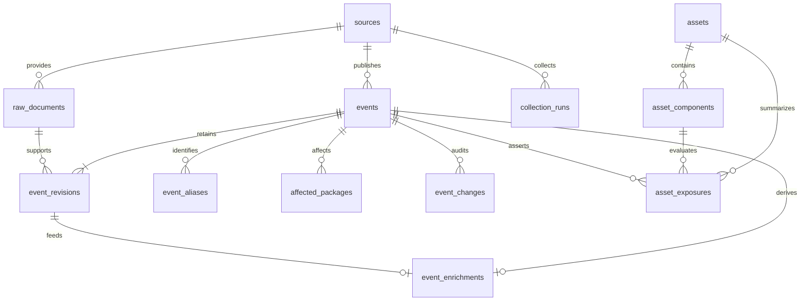

# 第一周数据模型与不变量

## 第七周生命周期补充

新增 `catalog_items`/`catalog_revisions` 仅存博客、指南、政策与 POC 模板的来源元数据，关联 `raw_documents` 保存精确响应哈希、MIME 和定位。POC 索引按 NDJSON 字节区间复验；缺失的发布时间保留 null。该目录不自动进入 `events`、`search_chunks` 或资产影响判断，不能推导漏洞有效性。

`intelligence_comparisons` 新增 `is_active` 和 `retired_at`。来源撤回或不足两源比较时，仅归档，保留事件关联、补证任务及复核历史。默认列表、新会话证据路径和当前统计只使用 active 项；归档历史可显式读取。

`comparison_review_changes` 新增 `change_kind` 与 observations 快照。来源更新、归档、重新出现都会递增 annotation_version，并标记 needs_evidence，保留人工备注；旧记录没有的快照保持 null，不伪造回填。

富化模式为 `structured-v2`，CPE 项保留父配置是否需完整求值的标志；匹配证据带 `conservative-match-v2`。多包范围按并集解释，无法确定的生态或 CPE 配置返回 unknown。不可变来源记录与历史引用不被这次升级改写。

## 当前实体

| 表 | 用途 | 关键约束 |
|---|---|---|
| sources | 来源注册 | 来源 ID 唯一 |
| raw_documents | 原文来源、哈希、采集时间和 live/replay 标记 | 来源、URL、哈希、模式共同去重 |
| events | 当前有效的情报状态 | 来源与外部编号唯一 |
| event_aliases | 当前 GHSA、CVE 别名 | 同一事件不重复保存同一别名 |
| affected_packages | 当前影响组件、版本范围和首个修复版本 | 仅保存来源声明，未实现版本求值 |
| event_revisions | 每次不同内容的完整快照与证据 | 事件与版本序号唯一 |
| event_changes | 入库、更新、冲突、人工备注审计 | 单调序号，仅用于本地审计 |
| collection_runs | 联网采集范围、状态、计数和失败原因 | 每次联网采集有独立 ID |
| sync_states | 每个来源/生态/组件的同步进度 | 完整成功后才推进 |
| event_enrichments | 当前版本的实体、版本范围、CVSS、CPE、质量标记和来源路径 | 每个事件一条，可从 revision 与原文重建 |
| enrichment_states | 富化模式版本、同步时间和覆盖统计 | 固定名称 structured |
| assets | 资产名称、环境、重要度与 SBOM 摘要 | 资产名称唯一，只保存清单哈希和元数据 |
| asset_components | CycloneDX 组件身份与版本 | 保留 purl/CPE/bom-ref，不猜测缺失版本 |
| asset_exposures | 组件与来源条件的派生比较 | 组件与事件唯一，绑定事件 revision 与富化版本 |
| intelligence_comparisons | 共享 CVE 的跨来源字段比较 | CVE 与字段唯一，不自动裁决来源 |

## 时间与状态语义

- `published_at`：上游公告首次发布时间。
- `source_updated_at`：上游当前记录的更新时间。
- `first_seen_at` / `last_seen_at`：本系统首次/最近观察该事件时间。
- `first_fetched_at` / `last_fetched_at`：某份相同来源原文的首次/最近获取时间。
- `collected_at`：该历史版本在本系统留档的时间。
- 时间必须含时区，数据库读取与 API 统一为 UTC-aware，前端转换成本地时间。
- `severity=unknown` 表示未知，评分缺失保留 null，不填 0。
- `withdrawn_at` 保留撤回时间，不物理删除历史。
- `source_asserted` 表示来自上游字段，未证明漏洞可复现。
- 人工核验状态与上游内容分开。已核验事件收到新的有效公告后自动变为 `needs_evidence`，并保留人工备注。

## 入库流程

1. 检查文档大小、JSON 类型、每条记录必要字段、时间和版本字段类型。
2. 完整校验一页后保存原始响应内容字节（HTTP 解压后的 JSON，不重新格式化）。
3. 用 SHA-256 定位原文文件，临时文件写入后原子替换；读取时再次校验哈希。
4. 以 `(source_id, external_id)` 查找事件，比较归一化内容指纹。
5. 同指纹：只更新最近观察时间，不增加情报版本。
6. 新更新时间：新版本成为 current，旧 current 改为 superseded。
7. 更旧的未见内容：保存 stale 历史，不覆盖当前内容。
8. 相同更新时间但不同内容：保存 conflict，不覆盖当前内容。
9. 整页提交事务；失败时整页回滚，前面已成功的页面可保留。

事件 `revision` 是**当前有效历史记录的序号**，不保证等于历史记录条数，因为 stale/conflict 也占用历史序号。历史默认倒序展示，B 应读取明确的 `current_revision`。

## 字段级证据

每个证据项包含 `field`、`raw_document_id`、`json_pointer`、`value`、`verification`。

例如 `/0/vulnerabilities` 指向分页响应第 1 条公告的完整组件数组。B 可读取原文，根据 JSON Pointer 还原字段。当前提供字段/数组级证据，尚未实现自然语言断言抽取、句子级引用、概率置信度与跨来源冲突判定。

## 第二周扩展边界

保留当前接口，新增来源适配器和产品别名；跨来源事件合并需要专门的映射与审计，不能直接把 CVE 设为唯一键。资产、SBOM、任务队列、语义索引和关系推理尚未落库，后续通过 Alembic 增量迁移。第一周不提前加入无人使用的复杂表。

## 第三周派生富化

`event_enrichments` 只对应当前 revision。新 current 版本进入时在同一事务替换；全量 `enrich` 按事件与当前 revision 对账。表中的结构化值不是新的来源事实，必须通过 `provenance` 返回 `raw_document_id + JSON Pointer` 核对。

版本范围解析坚持保守原则：明确比较符列表进入 `parsed`，缺失值为 `unknown`，无法安全解释的表达式为 `opaque` 并保留原文。CPE 只保存 NVD 配置条件，不执行资产命中。CVSS 保存全部有效来源条目；`selected` 只用于展示排序。

## 第四周资产与差异派生

CycloneDX 导入只把组件身份与版本落库，原始清单以 SHA-256 标识。包匹配要求生态和规范化名称相同；CPE 匹配要求 part、vendor、product 完全相同。版本求值仅接受明确比较符和可解析边界。任何不透明表达式、无法比较的版本或包/CPE 条件相互矛盾都进入 `unknown`。

`asset_exposures` 的证据保存事件、当前 revision、来源、外部编号和原始富化项。其 `affected`/`not_affected` 是来源条件比较结果，`independent_verification=false`。新 current 版本入库或重新富化时会在同一事务对账资产派生结果。

`intelligence_comparisons` 仅为至少两个来源共同声明的 CVE 创建比较项。严重性值不同为 `conflict`；CVSS 展示项或影响范围不同为 `variation`；值相同为 `agreement`。每个观察仍指向独立事件、revision 和原文定位，系统不合并记录或自动裁决。

## 第五周证据视图

第五周不复制不可变证据表，而是从 `event_revisions`、`raw_documents` 和 `asset_exposures` 确定性构建两个只读视图。事件 trace 对每一版原文重新做 SHA-256、JSON Pointer 和字段值校验，并按观察顺序计算顶层规范字段差异。资产 evidence graph 连接 asset、component、exposure、event、revision 和 raw document，同时复验来源条件指针。

这种设计避免缓存结果与原文发生漂移。trace 中的 `verified` 只表示证据完整性；revision 的 `stale` 或 `conflict` 不会因为出现在时间线中而变成 current。

## 第六周运维与评测数据

成员 B 新增 `chunk_embeddings` 与 `rag_runs`、`rag_evaluations`。向量通过 chunk 外键级联删除，记录模型文件摘要与片段内容摘要；查询同时核对事件当前 revision。RAG 运行记录保存输入、实际引用、工具预算/时延和异常分支。评测报告保存冻结集、语料、配置、模型版本和完整后端时延；正式人工金标未取得时总体正式得分为 null。

`monitor_states.heartbeat_at` 保存单个来源任务启动、分页提交和完成时的进展时间。worker pulse 文件单独反映进程存活，二者不混用。

`operational_evaluations` 保存采集新鲜度、运行耗时、富化覆盖、原文完整性和检查结果的时间快照。JSON 内时间使用带时区 ISO 8601 字符串；`run_at` 使用 UTCDateTime。轻量状态查询不保存快照、不逐个读取原文。

`recovery_actions` 保存调度中断恢复和派生重建动作、对象、状态及结果。只要原文完整性失败，重建记录为 blocked；不会伪造或修改来源证据。

`enrichment_evaluations` 保存冻结回归集的样本数、断言数、预期事实命中率和证据复验率。丢失样本不会从分母排除。当前题集属于 characterization，尚不具备独立人工金标的统计含义。

成员 B 第五周新增 `conversations`、`conversation_messages`、`conversation_hops` 和 `evidence_tasks`。会话只保存明确选择的 active asset；message 分别记录用户请求和助手答案快照；hop 保存每一步输入、输出与完整证据 ID；evidence task 保存待补字段、目标来源、完成条件及 `not_started` 联网状态。`conversation_evaluations` 保存固定六用例指标。所有对象都是审计与工作流数据，不会反写来源事件或把待办升级为事实。
