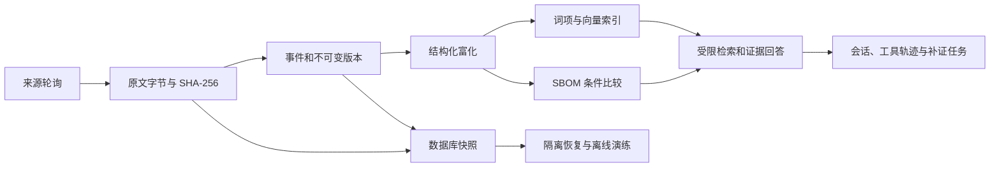

# 技术报告工程章节草稿

本章描述截至第八周的工程实现，可合并进正式 Word/PDF 技术报告。它不是独立金标准确率或最高奖项得分证明。

## 系统组成

后端采用 Python、FastAPI、SQLAlchemy 和 Alembic。开发主库使用 SQLite，Compose 提供 PostgreSQL 部署。前端为无需 Node 构建的 HTML/CSS/JavaScript；原文和外部资料以文本方式展示。FastEmbed/ONNX 在本机 CPU 上生成向量，当前回答仍为有引用的抽取式证据包。

## 数据与证据的一致性

来源响应以字节保存并计算 SHA-256。事件归一化后按来源标识和内容指纹幂等写入；较旧记录、同时间冲突和撤回均不会默默替换已有当前事实。每个 revision 保存原文 ID、字段 JSON Pointer、采集时间与内容快照。

结构化富化和索引是可重建派生数据。来源更新导致旧片段失效时，关联旧向量在同一事务删除；后台本地模型对账完成前，混合检索明确报告不完整。资产判断携带事件 revision 与匹配规则版本，复杂 CPE、未知生态或不可解释条件返回 unknown。

跨来源比较保留不同来源的观察。来源撤回时比较转为 inactive，保留人工复核和补证关系；来源更新后递增复核版本并标记 needs_evidence，防止旧页面覆盖新证据。

## 调度与故障恢复

采集器按目标保存水位、下一次运行时间、分页续传位置、失败次数和最近成功记录。单来源网络或解析失败不会伪造成功水位。进程重启可以恢复中断状态；数据库/锁的临时错误在后续周期重试。独立进程租约防止多个监测实例争用同一心跳。

`doctor --repair` 持有写锁，对可重建状态执行对账并保存恢复审计。原文损坏时阻止重建，避免用推测内容修复证据。Docker 使用非 root、只读根目录、持久卷、就绪检查和退出重启策略；健康检查本身不等于所有 unhealthy 进程会自动重启。

## 可观测性与实验口径

live/ready 接口区分进程响应与数据库/配置可用性。Prometheus 指标按路由模板聚合请求耗时，避免把用户问题和密钥写入标签；日志记录目标、状态和耗时。运行快照保存来源新鲜度和数据完整性，但字段覆盖率不称作准确率。

监测窗口将成功采集后的有效新鲜度区间取并集，并保留断档。它不是进程在线率，也不能直接证明“发布后 ≤6h”。问答评测区分开发回归、独立人工金标、完整后端时延与 HTTP 开销；B 的修正版结果应由独立报告支持。

## 第八周备份与恢复

备份工具对当前 SQLite 使用在线 Backup API，随后依据快照中 RawDocument 引用复制内容寻址原文。备份还记录源码、依赖锁、配置、人工审核材料及可选模型文件清单；不自动携带生产 `.env` 或整个虚拟环境。

每个文件保存大小和 SHA-256。恢复先验证清单、数据库完整性、外键和全部引用原文，再只向新目录复制；模型路径改为新根目录，文件摘要保持一致。恢复包没有认证签名，校验只能检测损坏和不一致，不能将陌生来源的包视为可信代码。

恢复服务固定使用副本源码、数据库、原文和模型，默认关闭 HTTP 写入及外部采集。需要现场演示回答时可显式提供独立演示密钥，仅写入恢复副本。当前主机已安装依赖的离线运行可以演练；异构新机器仍需提前安装依赖，不能称为无需环境的单文件程序。

## 双人协作与交付

A 负责采集、存储、富化、资产数据、运维、备份和工程说明；B 负责检索问答、语义策略、会话、质量评测及答辩展示。双方通过带版本的 API、原文定位、冻结协议和验收报告交接。

第八周联合交付应包含源代码、技术报告 Word/PDF、匿名化答辩材料、操作视频与离线预案。工程主线、恢复演练和固定回归通过，不代表人工金标、所有来源类别和长期 SLA 已完成；这些限制应在报告中明确保留。
