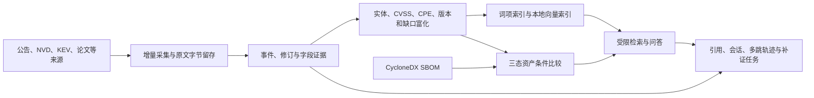

# 知盾：当前成果与从零使用指南

更新日期：2026-09-26。本指南依据当前代码、真实库快照和最近的验收记录。系统仍在比赛开发阶段；“已实现”指可运行功能，不等于达到赛题的全部优秀档指标。

## 一、系统能做什么

知盾将 AI 安全资料的采集、结构化加工、资产条件比较和可引用问答连接起来。数据路径如下：



### 模块与呈现

| 模块 | 已实现的主要功能 | 页面或接口 |
|---|---|---|
| 情报监测 | 五个 live 适配器覆盖四类来源、六个定时目标；水位、分页续传、失败退避、去重、撤回与历史留存 | `/`、`/api/v1/monitoring` |
| 原文与证据 | 原始响应字节 SHA-256、字段 JSON Pointer、事件版本、同 CVE 跨源对照、人工复核历史 | `/api/v1/events/{id}/trace`、`/api/v1/comparisons` |
| 结构化富化 | 实体、CVSS、版本范围、CPE、资料缺口；来源事实和派生字段分开 | `/api/v1/events/{id}/enrichment` |
| 资产比较 | 导入 CycloneDX JSON；按组件身份和支持的版本条件给出 `affected`、`not_affected`、`unknown` | `/assets`、`/api/v1/assets` |
| 检索与问答 | 词项及本地 embedding 混合检索、来源引用、抽取式回答、显式资产上下文、持久会话、五跳证据导航、待办式补证 | `/workspace`、`/api/v1/rag/*` |
| 运行管理 | live/ready 健康检查、指标、来源新鲜度、运行快照、doctor 修复审计、Compose 部署 | `/health/ready`、`/metrics`、`/api/v1/operations/status` |
| 扩展资料目录 | 博客、NIST 指南、政策和 POC 模板的元数据适配与独立审计 | `/catalog`、`/api/v1/catalog/items` |

当前回答采用有证据约束的抽取式证据包，受限工具规划会保存调用轨迹；没有上线自由生成大模型作为事实回答。`affected` 表示所选 SBOM 组件匹配某来源的身份和版本条件，不表示漏洞已复现；`not_affected` 只对该来源给出的范围有效；`unknown` 必须保留原因。相同 CVE 的来源记录分别保存，差异不会自动裁决。

## 二、从空环境安装并启动

要求 Python 3.11+，推荐 3.12。以下命令在**本项目根目录**执行。首次安装时创建虚拟环境；本工作区若已有 `.venv` 和 `.env`，可直接从 `init-db` 开始，不要覆盖已有配置。

```bash
python3.12 -m venv .venv
.venv/bin/python -m pip install -r requirements.lock
.venv/bin/python -m pip install --no-deps -e .
cp .env.example .env
.venv/bin/python -m zhidu init-db
.venv/bin/python -m zhidu serve
```

默认数据库为 `data/zhidu.db`，原文位于 `data/raw`。启动后访问：

- `http://127.0.0.1:8000/`：监测和情报总览。
- `http://127.0.0.1:8000/workspace`：B 的研究、检索、会话及问答工作台。
- `http://127.0.0.1:8000/assets`：资产条件判断和证据追溯。
- `http://127.0.0.1:8000/catalog`：扩展资料目录。需要运行已加载 0.12.0 路由的服务；修改 Python 后需重启。
- `http://127.0.0.1:8000/docs`：交互式 API 文档。

若 8000 被已有服务占用，可改为 `.venv/bin/python -m zhidu serve --port 8002` 并使用对应端口。默认 `ZHIDU_ADMIN_KEY` 为空，HTTP 写接口关闭；只有确需在页面提交问答、资产或人工复核时才在本机 `.env` 配置独立管理员密钥。不要提交 `.env` 或真实令牌。

刚初始化的数据库是空的。先按下一节做隔离演示，再决定是否进行联网采集。

## 三、不联网完成第一条全链路演示

以下两份 GHSA 与 SBOM 示例都是**虚构数据**。在新终端设置独立数据库和原文目录，避免与真实库混合：

```bash
export ZHIDU_DATABASE_URL=sqlite:///./data/demo-walkthrough.db
export ZHIDU_RAW_DIR=./data/demo-walkthrough-raw
.venv/bin/python -m zhidu init-db
.venv/bin/python -m zhidu import-json examples/ghsa-demo-v1.json
.venv/bin/python -m zhidu import-json examples/ghsa-demo-v1.json
.venv/bin/python -m zhidu import-json examples/ghsa-demo-v2.json
.venv/bin/python -m zhidu asset-import examples/cyclonedx-example-ai-demo.json \
  --asset-name demo-service --environment demo
.venv/bin/python -m zhidu serve --port 8001
```

前三次导入预期为 **created 1 → unchanged 1 → updated 1**。浏览 `http://127.0.0.1:8001/` 可看到 1 条事件和 2 个历史版本；`/assets` 应有 1 个示例资产、1 个组件、1 项 `affected` 来源条件匹配；`/workspace` 检索演示数据时选择 `replay` 来源。该链路已在临时隔离数据库实测通过。结束演示并返回默认库时，在该终端执行 `unset ZHIDU_DATABASE_URL ZHIDU_RAW_DIR`。若已有同名 demo 库，导入会按内容和版本幂等处理，统计不再等于首次运行结果。

## 四、接入真实资料与日常操作

`config/sources.json` 包含两个 GitHub 目标和 vLLM 厂商公告、NVD、CISA KEV、Crossref 论文元数据目标。首次或手工验收可运行一轮到期任务；需要持续采集则保持监测进程运行：

```bash
.venv/bin/python -m zhidu monitor --once
.venv/bin/python -m zhidu monitor --sync-semantic
```

`--sync-semantic` 只对账已准备的本地模型，不会自动下载模型。若只需要采集，可使用 `.venv/bin/python -m zhidu monitor`。停止监测进程用 Ctrl+C；服务退出或电脑睡眠后，来源可能超出同步周期，页面会如实显示告警。调度间隔不等于已经实测的发布至采集 SLA。

结构化富化和索引可人工对账：

```bash
.venv/bin/python -m zhidu enrich
.venv/bin/python -m zhidu index-sync
.venv/bin/python -m zhidu compare-sources
.venv/bin/python -m zhidu evidence-audit --output docs/evidence-current.json
.venv/bin/python -m zhidu doctor --output docs/doctor-current.json
```

实际资产需由团队自行提供 CycloneDX JSON：

```bash
.venv/bin/python -m zhidu asset-import path/to/real-bom.json \
  --asset-name production-api --environment production --criticality critical
.venv/bin/python -m zhidu asset-scan
```

真实 SBOM 可能包含敏感组件信息，先确认其使用范围；不要将示例 SBOM 导入真实库。

### 可选本地语义检索

基础词项检索不依赖模型。要使用混合 RAG，另安装 `requirements-semantic.lock`，并按 [B 第六周运行说明](member-b-week6-api.md)准备本地 embedding 模型，再对账：

```bash
.venv/bin/python -m pip install -r requirements-semantic.lock
.venv/bin/python scripts/prepare_week6_model.py
.venv/bin/python -m zhidu.rag_cli semantic-sync --output docs/semantic-current.json
```

模型准备可能需要联网；工作区已有模型时可按 B 文档从指定本地目录准备。当前实测的英文模型加上中文领域改写仍没有独立人工金标证明通用中文问答达到竞赛优秀档。新情报进入索引后需补齐对应向量，混合查询不会把旧向量当成新版本证据。

## 五、Docker/PostgreSQL 使用

在 `.env` 设置随机、URL-safe 的 `POSTGRES_PASSWORD`，然后执行：

```bash
docker compose up --build -d
docker compose --profile monitoring up --build -d
docker compose ps
```

第一个命令部署 PostgreSQL 与 API；第二个命令增加常驻采集容器。容器默认只绑定本机地址，数据库和原文存于持久卷，**不会迁移本地 SQLite 文件**。核心容器已独立实测数据库与 API 崩溃恢复；完整实验见 [A 第六周容器报告](member-a-week6-container-check.json)。容器的可选 embedding 模型与依赖需要单独准备，不能仅凭 API 健康检查认定混合 RAG 已就绪。

## 六、当前验收数字及其含义

2026-09-26 的真实库检查：672 个事件、802 个历史版本、3130 个当前检索片段与对应向量、37 条扩展目录回放元数据；真实库中的资产和会话为 0。最近一次扩展目录回归为 145 项测试通过；主链 3130 个当前片段和 4809 项历史字段证据通过此前的复验。这些是检查时的快照，不是固定上限。

本次检查还发现采集心跳已过期近 24 小时，当前没有可确认在运行的常驻采集进程；Crossref 目标最近状态为 failed。系统具备持续监测与失败退避功能，但在重新启动监测并观察后续成功记录前，不能称当前服务的实时性或来源新鲜度达标。

目录的 37 条回放分布为博客 14、NIST 指南 1、POC 模板元数据 22、政策严格筛选 0。新增四类适配代码已存在，**新增 live 行数仍为 0**，不能按“已完成 8 类实时来源”申报得分；详见 [扩展目录验收](member-a-catalog-acceptance.md)。POC 仅收集模板索引，未下载或执行 YAML。

B 的开发回归成绩和人工金标成绩必须分开。B 已补交支持率计算、中文改写和拒答修正；原集合中文 Recall@5 提升至 75%，固定拒答用例通过，但仍未达到独立盲测要求，127 条人工审核材料尚未完成。赛题目标是初赛和决赛均争取 90 分以上；当前**没有可证明的正式评委得分**，也不能把开发回归分数换算为最终评分。剩余重点是人工金标、中文与无证据问题质量、扩展来源 live 验收、持续监测时延，以及正式报告和答辩材料。

项目实测及接口说明可从 [A 第七周报告](member-a-week7-acceptance.md)、[B 第六周补交](member-b-week6-quality-resubmission.md)、[数据模型](data-model.md)和 [OpenAPI](openapi.json)继续阅读。
